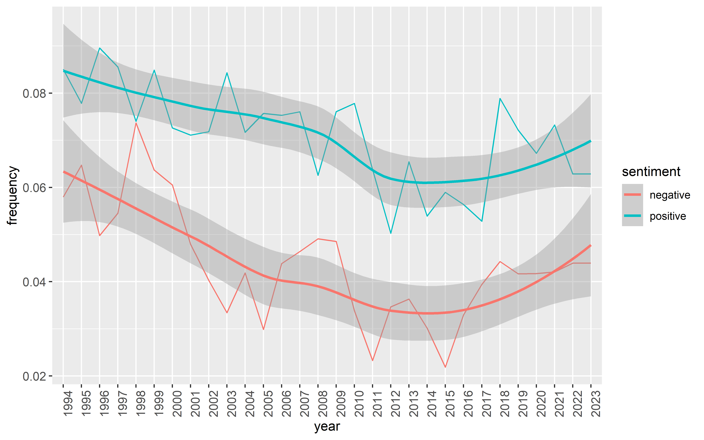
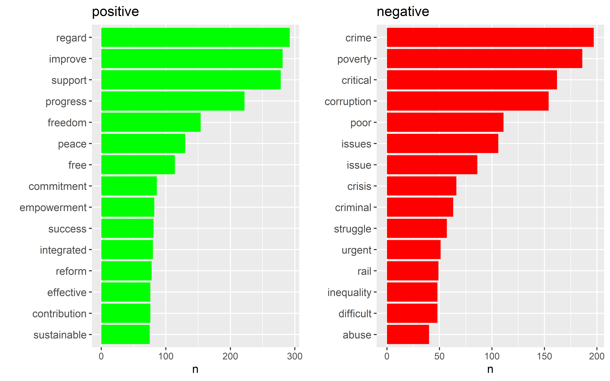
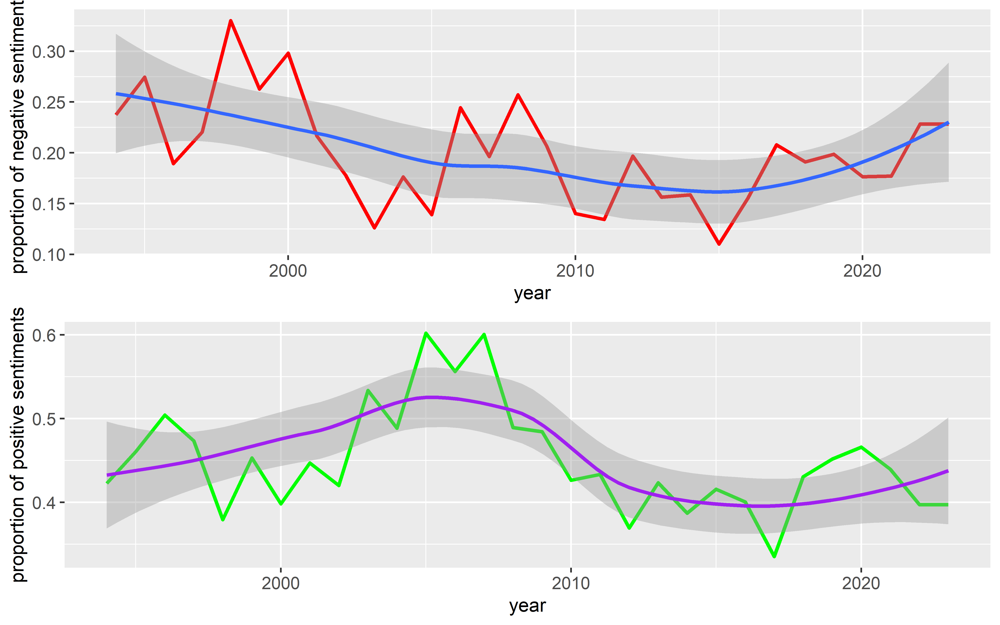
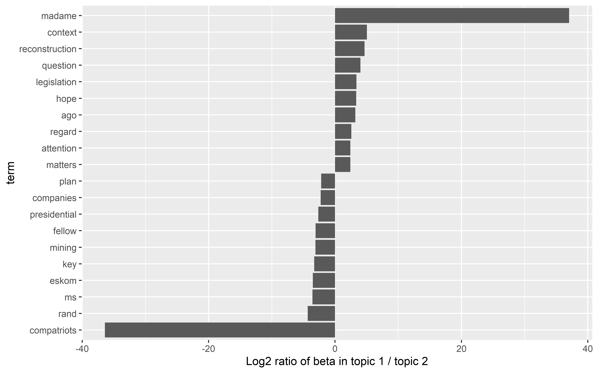
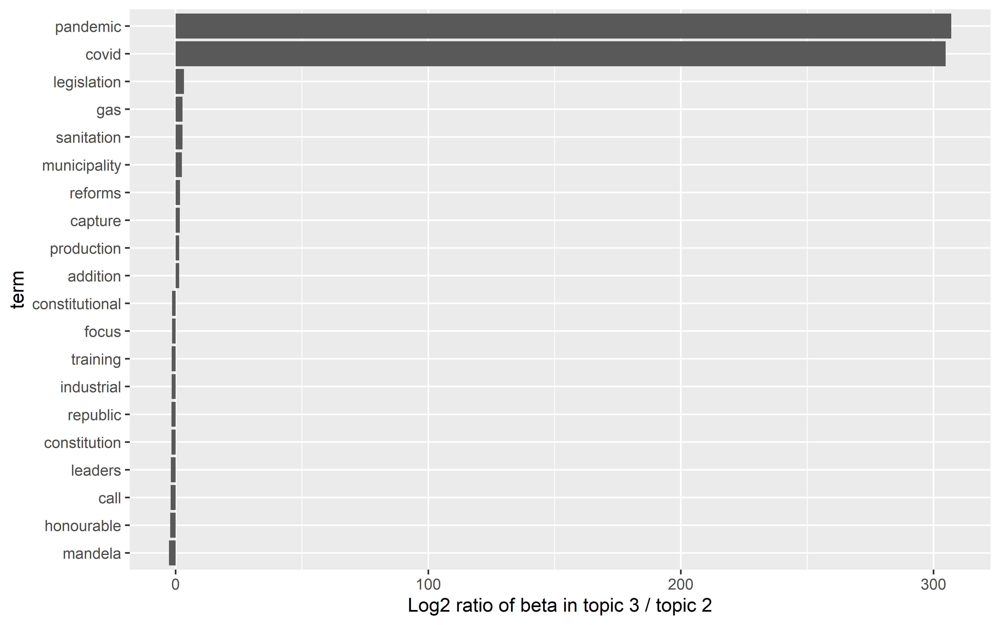
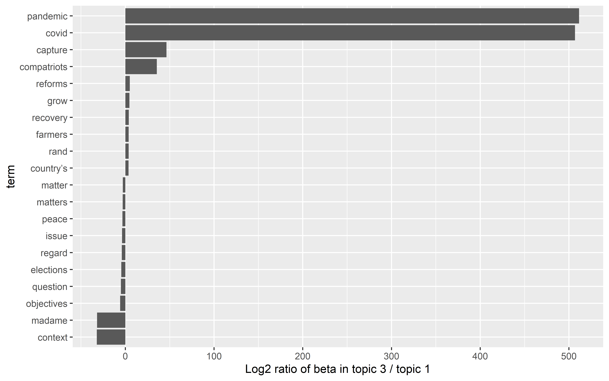

# Sentiment Analysis & Topic Modelling of South African SONA Speeches

<p align="center">
  
  
  
  
</p>

<p align="center">
  <strong>Exploring sentiment, language and underlying themes in South African presidential speeches (1994–2023).</strong>
</p>

---

## Project Overview

An academic data science project analysing South African State of the Nation Address (SONA) speeches from 1994 to 2023 using sentiment analysis and topic modelling.

The objective is to explore differences in language, sentiment and recurring themes across presidential speeches.

## Tools & Technologies

- **R** – Data processing and analysis.
- **Quarto** – Research reporting and publishing.
- **tidyverse** – Data manipulation.
- **tidytext** – Text mining and tokenisation.
- **topicmodels** – LDA topic modelling.
- **ggplot2** – Data visualisation.

## Methodology

**1. Text preprocessing**
- Tokenisation of speeches into words and sentences.
- Removal of stop words and unnecessary text.
- Organisation of speeches by president and year.

**2. Sentiment analysis**
- Application of the Bing sentiment lexicon.
- Classification of words as positive, negative or neutral.
- Comparison of sentiment across presidents and years.
- Sentence-level sentiment analysis.

**3. Topic modelling**
- Construction of a document-term matrix.
- Application of Latent Dirichlet Allocation (LDA).
- Exploration of three underlying topics.
- Comparison of word-topic probabilities.

---

## Selected Visualisations

### 1. Sentiment Trends (1994–2023)

Examining how positive and negative word frequencies changed across the period.



### 2. Most Common Positive and Negative Words

Identifying the 15 most frequently occurring positive and negative words across the speeches.



### 3. Sentiment at Sentence Level

Exploring changes in the proportions of positive and negative sentences over time.



### 4. Topic Modelling

Comparing the most distinctive words across the three LDA topics using word-topic probabilities.

**Topic 1 vs Topic 2**



**Topic 2 vs Topic 3**



**Topic 1 vs Topic 3**



---

## 💡 Key Findings

- Positive word frequencies were generally higher than negative word frequencies across the period.
- Positive sentence sentiment peaked around 2005–2009, followed by a decline.
- Words associated with crime, poverty and corruption featured prominently among the negative terms.
- The LDA model identified substantial similarities between topics, with pandemic-related vocabulary distinguishing one topic.
- Speeches from the COVID-19 period were associated with terms such as *pandemic* and *COVID*.

## 📂 Repository Structure

```text
Assignment_2/
│
├── docs/
│   ├── assignment2.html
│   ├── LLM.html
│   └── assignment2_files/
│       └── figure-html/
│           └── Research plots
│
├── LLM.qmd
├── assignment2.qmd
├── index.qmd
├── Sentiment1.R
├── sentiment2.R
├── topic1.R
├── data.RData
├── dsfi-lexicons.Rdata
├── ref.bib
├── _quarto.yml
└── README.md
```

## Project Website & Report

- [View the published project website](https://sihlenjn.github.io/Assignment_2/)
- [Explore the main research report](docs/assignment2.html)
- [View the source repository](https://github.com/sihlenjn/Assignment_2)


---


